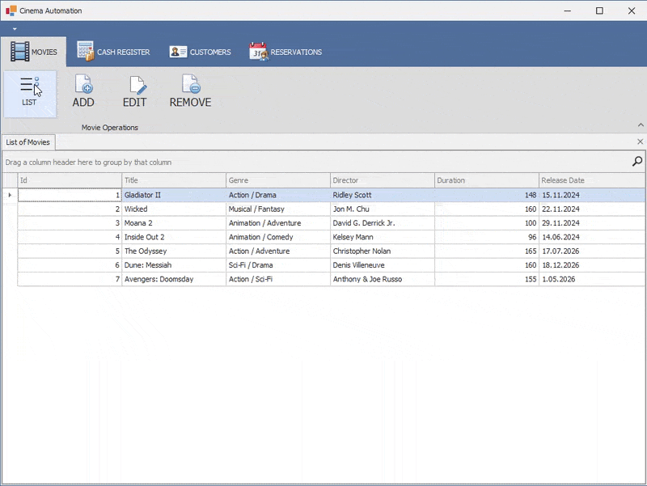
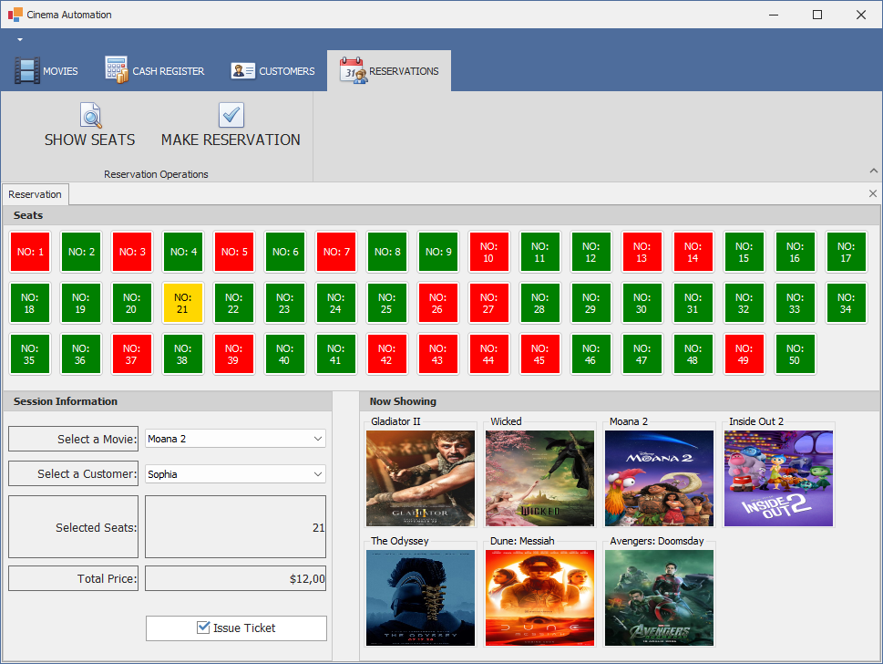
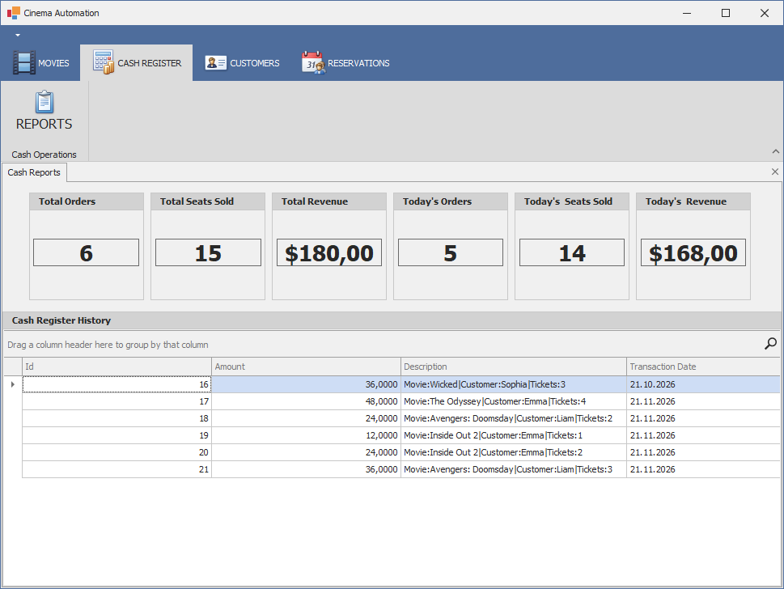
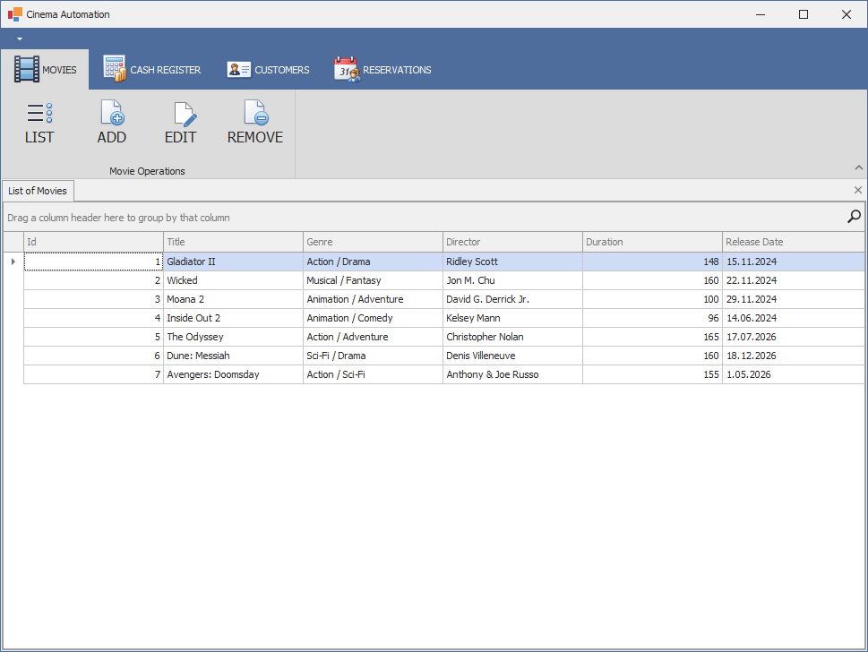
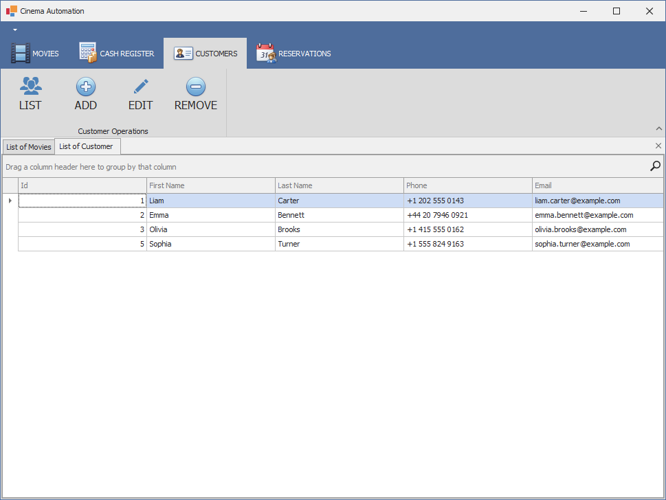

# DevExpress Cinema Automation

DevExpress Cinema Automation is a Windows desktop application for managing cinema reservations, ticket sales, movies, and customers. Cinema staff can browse movies, check seat availability, reserve multiple seats in one transaction, and review sales from the cash register dashboard.

The application is built with C# WinForms, DevExpress WinForms controls, Entity Framework 6, and SQL Server LocalDB.

## Application Demo



## Features

| Feature | What you can do |
| --- | --- |
| Now Showing | Browse currently showing movies and view their posters. |
| Seat Selection | See which seats are available or occupied, select multiple seats, and review the total ticket price before confirming. |
| Ticket Reservations | Record a reservation and issue tickets for the selected seats. |
| Cash Register & Sales Reports | Review each transaction's movie, customer, ticket count, and revenue. Track order counts, seats sold, and revenue through daily and overall totals. |
| Movie Management | View, add, edit, and delete movie records. |
| Customer Management | View, add, edit, and delete customer records. |

## Screenshots

| Seat Reservation | Cash Register & Sales Reports |
| :---: | :---: |
|  |  |

| Movie Management | Customer Management |
| :---: | :---: |
|  |  |

## Architecture

The solution uses an N-tier architecture that separates the desktop interface, business rules, data access, and domain models.

| Project | Responsibility |
| --- | --- |
| `DevExpressCinemaAutomation` | Presentation layer. Contains the WinForms screens and DevExpress controls used to manage movies, customers, reservations, and sales. |
| `CinemaAutomation.Business` | Business layer. Provides application services and validates business rules. |
| `CinemaAutomation.DataAccess` | Data access layer. Manages database operations and entity mappings through Entity Framework 6. |
| `CinemaAutomation.Entities` | Domain layer. Defines models such as `Movie`, `Customer`, `Seat`, `Reservation`, and `CashRegister`. |

## Getting Started

### Prerequisites

- Windows with Visual Studio 2022 and the **.NET desktop development** workload
- .NET Framework 4.8 targeting pack
- DevExpress WinForms 26.1.6
- SQL Server Express LocalDB with the `MSSQLLocalDB` instance

### Installation

1. Clone the repository:

   ```bash
   git clone https://github.com/halegulsipahi/DevExpressCinemaAutomation.git
   ```

2. Open `DevExpressCinemaAutomation.sln` in Visual Studio.
3. In **Solution Explorer**, right-click the solution and select **Restore NuGet Packages**. This restores the project's NuGet dependencies, including Entity Framework 6.5.2.
4. Open `DevExpressCinemaAutomation/App.config` and check the `connectionStrings` section. The default configuration connects to the `CinemaAutomationDb` database on `(localdb)\MSSQLLocalDB` using Windows authentication. If you use a different SQL Server instance, update the `Data Source` value.
5. In **Solution Explorer**, right-click the WinForms project (`DevExpressCinemaAutomation.UI.csproj`) and select **Set as Startup Project**.
6. Press **F5** to build and run the application.

### Optional Movie Posters

To display posters in the **Now Showing** panel, create a `Posters` folder in the application's output directory. For a Debug build, use `DevExpressCinemaAutomation/bin/Debug/Posters/`.

Save each poster as a `.jpg` file named after its movie ID. For example, use `1.jpg` for movie ID `1`.
